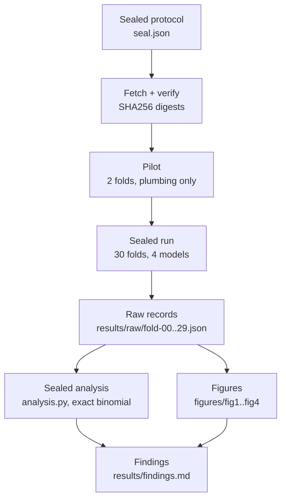
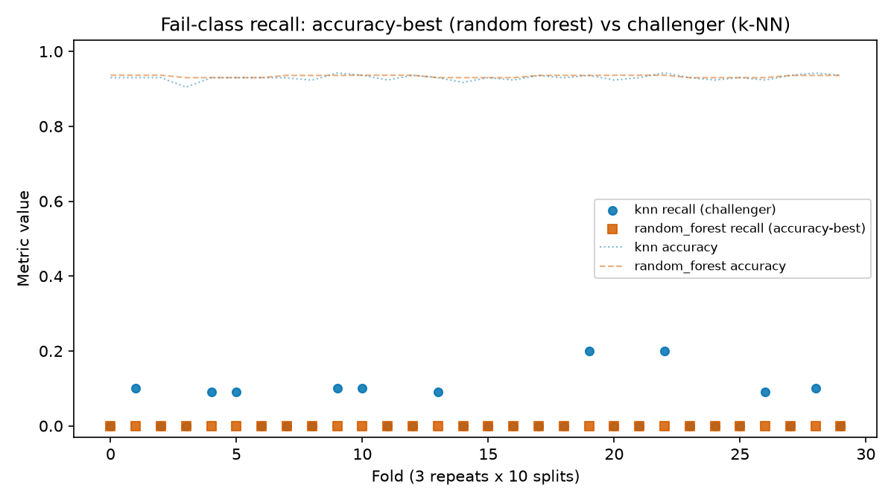
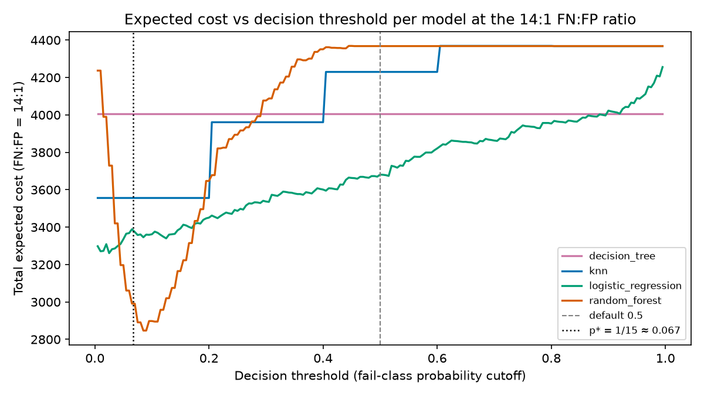
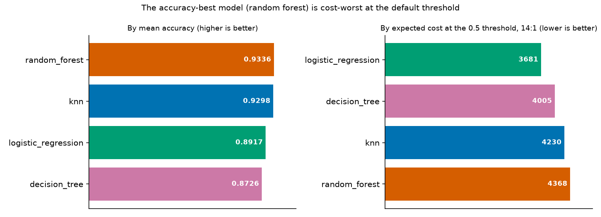
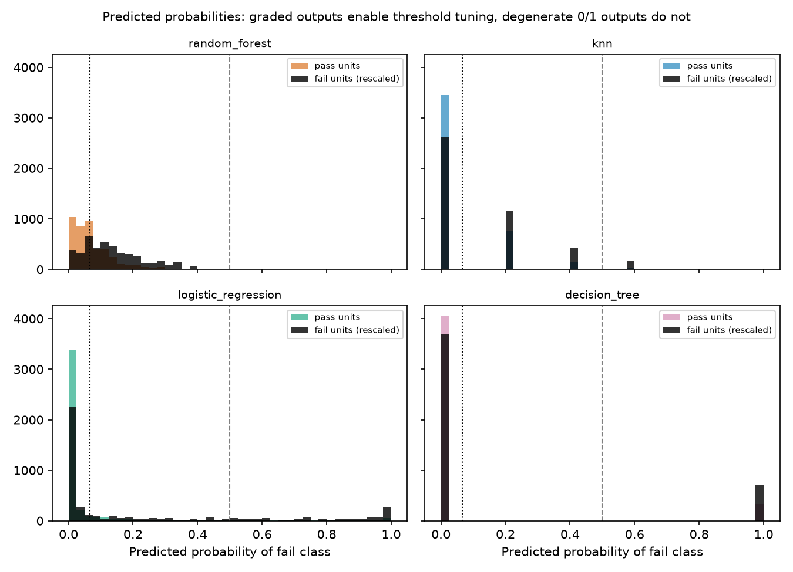
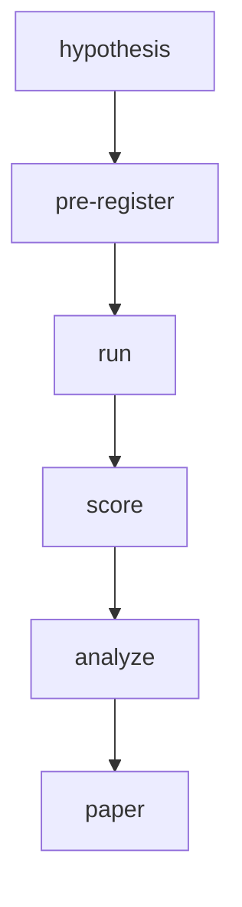

<div align="center">

# Classifier Cost Exhibit

[](LICENSE)
[](results/findings.md)
[_seeded-blue)](seal.json)
[](https://archive.ics.uci.edu/dataset/179/secom)

</div>

Classifier Cost Exhibit is a pre-registered evaluation on the UCI SECOM dataset testing whether the accuracy-optimal classifier misses more defects than a lower-accuracy alternative under an explicit error-cost matrix, and whether a cost-aligned decision threshold (p* = FP/(FP+FN)) reverses the ranking. The experiment is committed before it runs: the splitter, preprocessing pipeline, models, seeds, cost ratios, and statistical test are fixed in [seal.json](seal.json) before any sealed fit() call, results are collected as raw per-fold records with full y_true/y_prob arrays, and every reported number re-derives from [results/raw/](results/raw/) by the committed [analysis.py](analysis.py) against the schema in [DATA_DICTIONARY.md](DATA_DICTIONARY.md). **Outcome: the accuracy-best random forest misses every defect (mean fail recall 0.0000) while the second-ranked k-NN challenger misses fewer (0.0388; two-sided exact binomial sign test on the 10 nonzero folds, 10/10 favor the challenger, p = 0.002).** At the default 0.5 threshold the random forest is cost-worst (4368 vs 3681 for logistic regression at the 14:1 FN:FP ratio); at the cost-aligned threshold p* = 1/15 it becomes cost-best (2991) — threshold alignment, not a different model, is the production fix.

## Status

**Sealed primary result: the inversion holds (p = 0.002); the co-primary cost ranking flips at the default threshold and reverses again at p\*.** The sealed 30-fold run is complete and its findings are in [results/findings.md](results/findings.md). The pilot dry run ([results/pilot/](results/pilot/)) passed its plumbing checks before the seal and is excluded from the primary analysis. Descriptive analyses beyond the pre-registered endpoints (the 10:1 cost sensitivity, the sweep behind Figure 2) are labeled as such in the findings.

## Experiment Index

| Slug | Question | Status | Key Result |
|------|----------|--------|------------|
| `secom-cost-threshold` | Does the accuracy-optimal classifier miss more defects than a lower-accuracy alternative, and does a cost-aligned threshold (p* = FP/(FP+FN)) reverse the ranking? | complete | inversion holds, p = 0.002; accuracy-best is cost-worst at 0.5, cost-best at p* ([results/findings.md](results/findings.md)) |

## Pipeline



The rendered diagram is optional; the Mermaid source above is the canonical artifact and is committed inline in this README.

## Endpoints

*Table 1: Mean metrics per model over the 30 fold-evaluations (`results/raw/fold-00..29.json`; re-derive with `uv run python analysis.py --records results/raw --seal seal.json`).*

| Rank | Model | Mean accuracy | Mean fail recall | Mean fail precision |
| --- | --- | --- | --- | --- |
| 1 | random forest | 0.9336 | 0.0000 | 0.0000 |
| 2 | k-NN (challenger) | 0.9298 | 0.0388 | 0.1944 |
| 3 | logistic regression | 0.8917 | 0.2182 | 0.2095 |
| 4 | decision tree | 0.8726 | 0.1603 | 0.1337 |

*Table 2: Primary endpoint summary (sealed analysis, `results/raw/analysis.json`).*

| Measure | Value |
| --- | --- |
| Mean fail recall, accuracy-best (random forest) | 0.0000 |
| Mean fail recall, challenger (k-NN) | 0.0388 |
| Nonzero per-fold differences | 10 of 30 |
| Challenger better on nonzero folds | 10/10 |
| Two-sided exact binomial sign test | p = 0.00195 (< 0.05) |
| Descriptive inversion count | 10/30 folds |

*Table 3: Co-primary endpoint, expected cost at the 14:1 FN:FP baseline (`expected_cost = FN_cost x FN + FP_cost x FP`).*

| Model | Cost at 0.5 | Cost at p* = 1/15 |
| --- | --- | --- |
| random forest | 4368 | **2991** |
| k-NN | 4230 | 3556 |
| logistic regression | **3681** | 3380 |
| decision tree | 4005 | 4005 |

Sensitivity at the 10:1 ratio preserves the p* ordering (logistic regression 2620, random forest 2659, k-NN 2808, decision tree 2957).

## Figures

All figures derive only from the committed raw records via the committed scripts in `figures/`; regenerate with `uv run --with matplotlib python figures/<script>.py`. (Colors use the Okabe-Ito colorblind-safe palette.)



*Figure 1: Per-fold fail-class recall (markers) and accuracy (lines) over the 30 fold-evaluations. The accuracy-best random forest is at zero recall in all 30 folds; the k-NN challenger has nonzero recall in 10 of 30 (0.09-0.20) while matching its accuracy within 0.004.*



*Figure 2: Expected cost versus decision threshold per model at the 14:1 FN:FP ratio; dashed vertical marks the default 0.5 threshold, dotted vertical the cost-aligned p\* = 1/15. The random forest's cost minimum lies at p\*; the decision tree is threshold-invariant.*



*Figure 3: Ranking by mean accuracy (left) versus expected cost at the default 0.5 threshold, 14:1 FN:FP (right). The random forest moves from first to last.*



*Figure 4: Predicted fail-class probability distributions per model (fail units rescaled for visibility); dashed vertical at 0.5, dotted at 1/15. Random forest and logistic regression produce graded outputs; the decision tree is degenerate at 0 and 1.*

## Repository Layout

- [seal.json](seal.json) - the pre-registered protocol: pinned dataset digests, splitter, models, numeric guards, tests, cost ratios
- `pipeline.py` - fold runner; reads every parameter from the seal, verifies checksums, writes per-fold records
- [analysis.py](analysis.py) - pre-registered analysis; `--plumbing-only` for no-peeking checks
- [results/raw/](results/raw/) - 30 sealed per-fold records plus the derived `analysis.json`
- [results/pilot/](results/pilot/) - pilot records and note, excluded from the primary analysis
- [results/findings.md](results/findings.md) - sealed findings: Methodology, Results, Caveats
- `figures/` - one Python script plus one PNG per figure
- [METHODOLOGY.md](METHODOLOGY.md) - shared experimental design contract
- [DATA_DICTIONARY.md](DATA_DICTIONARY.md) - schemas for the seal and per-fold records

## Reproduction

1. Clone the repository.
2. Fetch and verify the dataset into `data/` (instructions and expected SHA256 digests in [results/README.md](results/README.md)).
3. Validate all schemas (needs only the standard library via [uv](https://docs.astral.sh/uv/)):

   ```bash
   uv run python validate_schema.py
   ```

4. Re-run the sealed evaluation (needs scikit-learn and numpy):

   ```bash
   uv run --with scikit-learn python pipeline.py --seal seal.json --data-dir data --out-dir results/raw
   uv run python analysis.py --records results/raw --seal seal.json
   ```

5. Regenerate figures:

   ```bash
   uv run --with matplotlib python figures/fig1-recall-inversion.py   # and fig2..fig4
   ```

## Citing This Work

See [CITATION.cff](CITATION.cff). Version 0.1.0, released 2026-11-15, author Hugues Clouâtre (ORCID 0009-0002-4291-1999); a Zenodo DOI will be minted at the first archived release.

## Lifecycle


