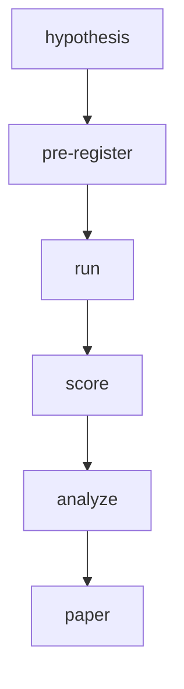

<p align="center">
  <a href="https://conventionalcommits.org"></a>
  <a href="https://docs.github.com/en/repositories/creating-and-managing-repositories/creating-a-repository-from-a-template"></a>
</p>

<h1 align="center">Classifier Cost Exhibit</h1>

Classifier Cost Exhibit is a pre-registered evaluation on the UCI SECOM dataset testing whether the accuracy-optimal classifier misses more defects than a lower-accuracy alternative under an explicit error-cost matrix, and whether a cost-aligned decision threshold (p* = FP/(FP+FN)) reverses the ranking. Each experiment is committed before it runs: a protocol, runner prompt, and scorer prompt are fixed in git, results are collected as raw sessions, scoring is performed blind against a rubric, and the analyzed record validates against the schema in [DATA_DICTIONARY.md](DATA_DICTIONARY.md) in CI. This structure makes every reported number traceable to a pre-registered design and reproducible by anyone with repository access.

## Lifecycle



The rendered diagram is optional; the Mermaid source above is the canonical artifact and is committed inline in this README.

## Experiment Index

| Slug | Question | Status | Key Result |
|------|----------|--------|------------|
| `secom-cost-threshold` | Does the accuracy-optimal classifier miss more defects than a lower-accuracy alternative, and does a cost-aligned threshold (p* = FP/(FP+FN)) reverse the ranking? | planned | — |

## Repository Layout

- `experiments/` - one directory per pre-registered experiment (see [experiments/README.md](experiments/README.md))
- `recipe/` - analysis notebooks and scripts that regenerate figures
- `figures/` - generated figures
- [METHODOLOGY.md](METHODOLOGY.md) - shared experimental design contract
- [DATA_DICTIONARY.md](DATA_DICTIONARY.md) - schema for `analysis.json` and `scores.json`
- [CITATION.cff](CITATION.cff) and `.zenodo.json` - citation metadata

## Reproduction

1. Clone the repository and check out the tag matching the release.
2. Install [uv](https://docs.astral.sh/uv/).
3. Validate the dataset schema:

   ```bash
   uv run python validate_schema.py
   ```

4. Regenerate figures from the recipes in `recipe/`.

Each experiment directory under `experiments/` contains its protocol, runner and scorer prompts, raw sessions, and analysis records, so any result can be traced back to its pre-registered design.

## Citing This Work

See [CITATION.cff](CITATION.cff). Version 0.1.0, released 2026-11-15, author Hugues Clouatre (ORCID 0009-0002-4291-1999); a Zenodo DOI will be minted at the first archived release.

## Exhibit Design

The experiment fixes an error-cost matrix and a pre-registered decision-threshold rule before any model is fit. Two candidate classifiers are compared: the accuracy-optimal choice and a lower-accuracy alternative chosen for fewer false negatives. The primary endpoints are total cost under the matrix at the default 0.5 threshold and at the cost-aligned threshold p* = FP/(FP+FN); the exhibit tests whether threshold alignment alone reverses the accuracy ranking.
