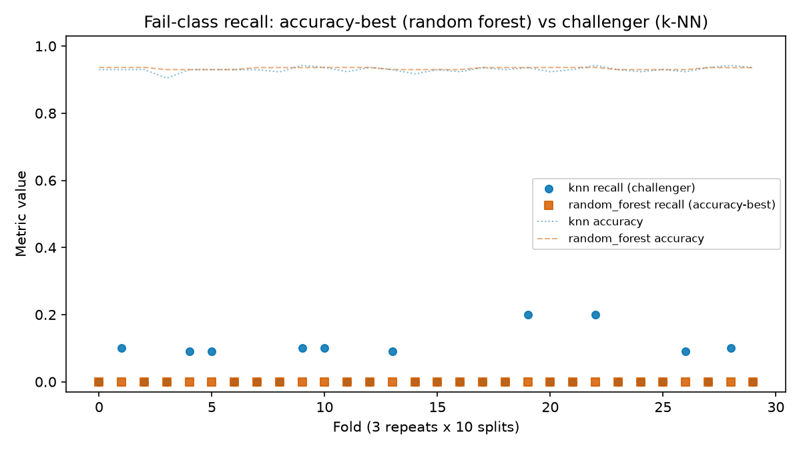
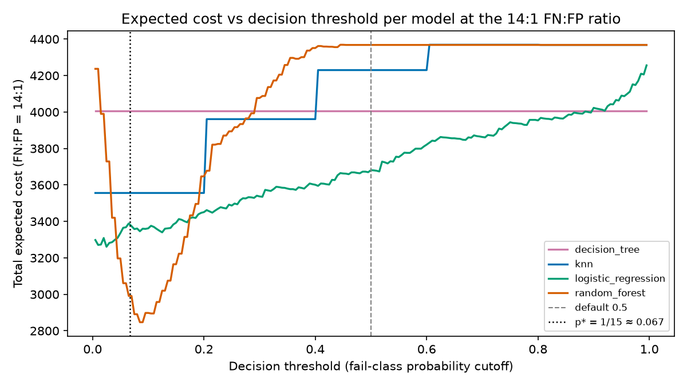
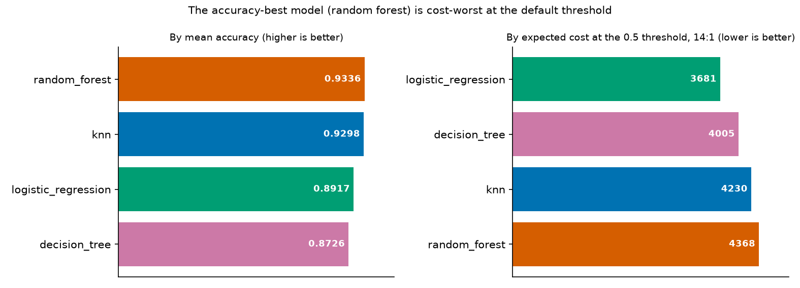
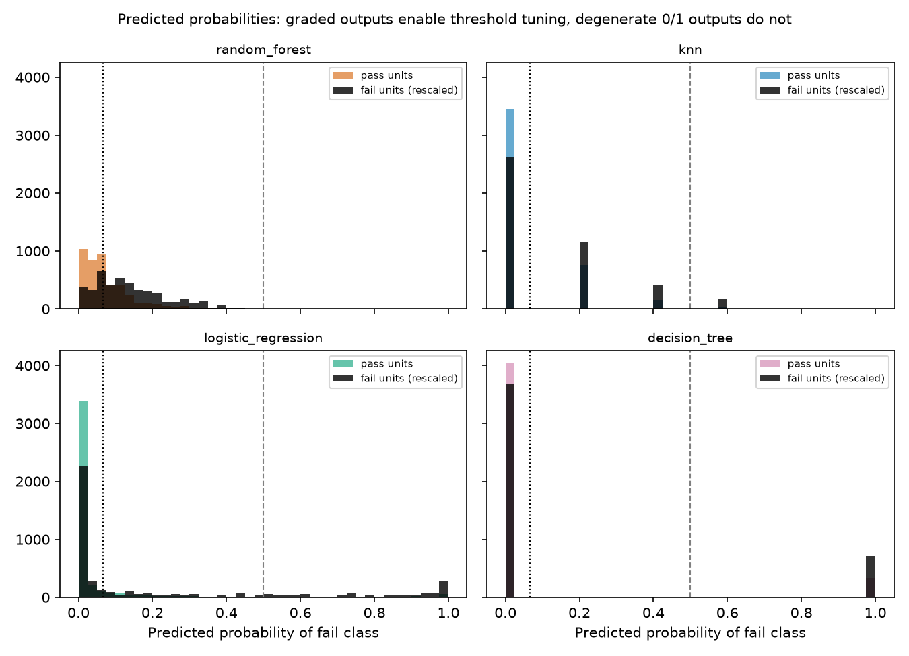

# Findings: accuracy vs fail-class recall inversion on UCI SECOM

Sealed analysis of the `secom-cost-threshold` experiment. Every number below is
re-derived from `results/raw/fold-*.json` by the committed `analysis.py`
against the pre-registered `seal.json`; nothing is hand-computed. The pilot
records under `results/pilot/` are excluded.

## Methodology

- Dataset: UCI SECOM (id 179), 1,567 units x 590 sensor features, 1,463 pass /
  104 fail labels (6.6% fail); SHA256 digests pinned in `seal.json` and
  verified before the run.
- Models (sklearn defaults, `random_state=0` where applicable): k-NN, decision
  tree, random forest, logistic regression (`max_iter=1000`).
- Pipeline per fold, fit on training folds only: median imputation, variance
  drop (`std < 1e-12`), correlation drop (`|r| > 0.95`, lower-indexed column
  kept), `StandardScaler`.
- Splits: `RepeatedStratifiedKFold(n_splits=10, n_repeats=3, random_state=0)`
  = 30 fold-evaluations; each unit is evaluated exactly 3 times with equal
  weight.
- Primary test: two-sided exact binomial sign test on per-fold fail-class
  recall differences (challenger minus accuracy-best), nonzero differences
  only, alpha = 0.05.
- Cost analysis: `expected_cost = FN_cost * FN + FP_cost * FP` at the 14:1
  FN:FP baseline and a 10:1 sensitivity, at the 0.5 threshold and at
  `p_star = 1.0 / (1.0 + 14.0)`.

## Results

### Accuracy ranking (mean over 30 folds)

| Rank | Model | Mean accuracy | Mean fail recall | Mean fail precision |
| --- | --- | --- | --- | --- |
| 1 | random forest | 0.9336 | 0.0000 | 0.0000 |
| 2 | k-NN | 0.9298 | 0.0388 | 0.1944 |
| 3 | logistic regression | 0.8917 | 0.2182 | 0.2095 |
| 4 | decision tree | 0.8726 | 0.1603 | 0.1337 |

### Primary endpoint: inversion holds

The accuracy-best model (random forest) misses **every** defect across all 30
test folds (mean fail recall 0.0000; precision identically 0.0000, since it
never predicts the fail class at all: its maximum predicted fail probability
is 0.45, below the 0.5 cutoff on every unit). The challenger (k-NN, second by
mean accuracy) misses fewer: mean fail recall 0.0388, with nonzero recall in
10 of 30 folds (0.09 and 0.10 in four folds each, 0.20 in two).

Accuracy is not a consolation for the challenger: on per-fold accuracy the
random forest is better in 14 of 17 nonzero folds (descriptive addendum, not
the pre-registered test; two-sided exact binomial p ≈ 0.013) - it is
significantly more accurate and defect-blind at the same time.

Sign test (pre-specified): per-fold recall difference is nonzero in 10 of 30
folds; the challenger has higher recall in **10 of 10 nonzero folds**
(two-sided exact binomial p = 0.00195 < 0.05). Descriptive inversion count:
10/30 folds (below a majority, driven by the 20 tied folds where both models
predict no fails); the inferential report is 10/10 on nonzero differences per
the pinned tie rule.

### Co-primary endpoint: threshold alignment reverses the cost ranking

This is the seal's pinned threshold comparison
(`cost_analysis.thresholds_compared`: 0.5 vs `p_star` at the baseline ratio),
reported descriptively per the pre-registration; the sweep behind Figure 2 is
likewise descriptive.

Expected cost (14:1 baseline), pooled over all folds. Pooling weights each
of the 1,567 units exactly 3 times (once per repeat), i.e. equally:

| Model | Cost at 0.5 | Cost at p* = 1/15 |
| --- | --- | --- |
| random forest | 4368 | **2991** |
| k-NN | 4230 | 3556 |
| logistic regression | **3681** | 3380 |
| decision tree | 4005 | 4005 |

At the default 0.5 threshold the accuracy-best model is cost-**worst** (4368,
Figure 3): the ranking flips against accuracy. At the cost-aligned threshold
p* = 1/15 the same random forest becomes cost-**best** (2991): the model
family that misses every defect at the default threshold wins on total
expected cost once the threshold matches the cost matrix (Figure 2). The
mechanism is visible in Figure 4: random-forest probabilities are graded
(pooled median 0.06, 95th percentile 0.23, maximum 0.45 - never crossing the
default cutoff), so a lower threshold trades cheap false positives for
expensive false negatives (at p* the random forest buys 83 FN instead of 312
for 1,829 FP); the decision tree's degenerate {0, 1} outputs make the
threshold irrelevant (4005 at both thresholds).

Sensitivity at 10:1 preserves the ordering at p* (logistic regression 2620 <
random forest 2659 < k-NN 2808 < decision tree 2957; random forest and
logistic regression effectively tie). The sensitivity ratio changes the cost
weights only; the threshold comparison still uses 0.5 vs p* = 1/15 (a 10:1
ratio would imply its own aligned threshold of 1/11, which the
pre-registered run does not evaluate).

`analysis.json` records `ranking_flip_vs_accuracy: false`: that flag compares
the **p\*** cost ranking with the accuracy ranking (random forest is first in
both). The ranking flip the exhibit highlights is at the **default 0.5
threshold**, where random forest drops from first by accuracy to last by
cost.

Figures:



*Figure 1: Per-fold fail-class recall (markers) and accuracy (lines) over the 30 fold-evaluations. The accuracy-best random forest is at zero recall in all 30 folds; the k-NN challenger has nonzero recall in 10 of 30 (0.09-0.20) while matching its accuracy within 0.004.*



*Figure 2: Expected cost versus decision threshold per model at the 14:1 FN:FP ratio; dashed vertical marks the default 0.5 threshold, dotted vertical the cost-aligned p\* = 1/15. The random forest's cost minimum lies at p\*; the decision tree is threshold-invariant.*



*Figure 3: Ranking by mean accuracy (left) versus expected cost at the default 0.5 threshold, 14:1 FN:FP (right). The random forest moves from first to last.*



*Figure 4: Predicted fail-class probability distributions per model (fail units rescaled to the pass count for visibility); dashed vertical at 0.5, dotted at 1/15. Random forest and logistic regression produce graded outputs; the decision tree is degenerate at 0 and 1; k-NN is coarse and discrete.*

Regenerate all figures from committed records with
`uv run --with matplotlib python figures/fig<N>-*.py`.

## Caveats (pre-drafted in clouatre-labs/clouatre.ca#2317)

- Single dataset (UCI SECOM); no claim of generality beyond this exhibit.
- sklearn defaults only; the exhibit's claim concerns metric and threshold
  choice, not model tuning.
- One seed family (`random_state=0`).
- Granularity: ~10 defects per test fold, so a single prediction shifts fold
  recall by ~10%; the sign test across folds is the inferential guard, not
  any single fold's recall.
- Cost ratios are illustrative, not measured line economics.
- Training folds overlap within and across repeats; equal-weight evaluation
  removes the weighting distortion, not the reuse.
- The primary test rests on only 10 nonzero folds; the p-value is exact for
  those, but the tied majority limits sensitivity.

## Reproduction

```sh
# fetch and verify the dataset into data/ (see results/README.md)
uv run python validate_schema.py                 # schema of seal + all records
uv run python pipeline.py --seal seal.json --data-dir data --out-dir results/raw
uv run python analysis.py --records results/raw --seal seal.json
uv run --with matplotlib python figures/fig1-recall-inversion.py  # and fig2..fig4
```

scikit-learn 1.9.1 and numpy were used for the run; analysis, validation, and
figures need no dependency beyond stdlib (matplotlib is ephemeral via
`uv run --with`).
